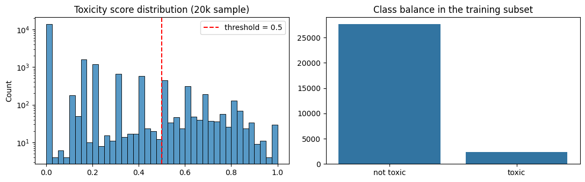
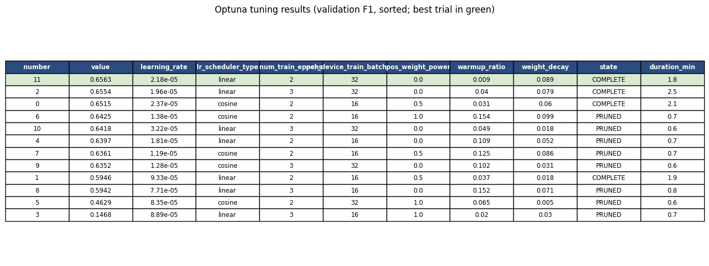
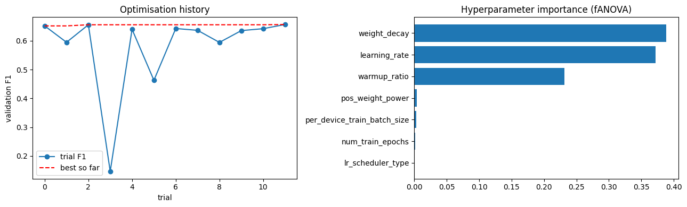
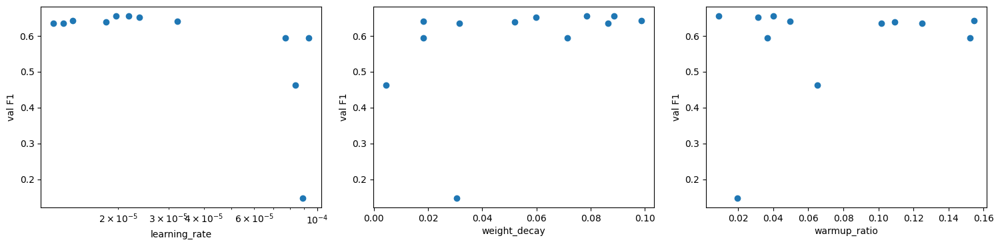
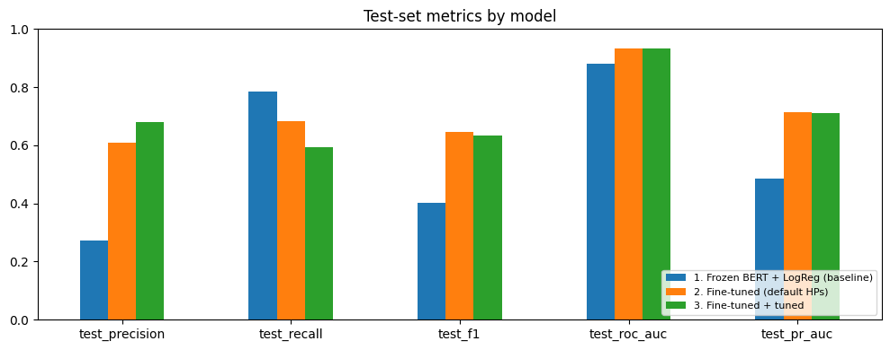
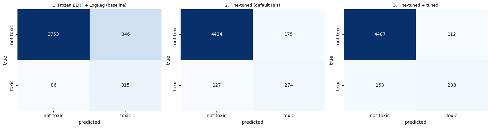
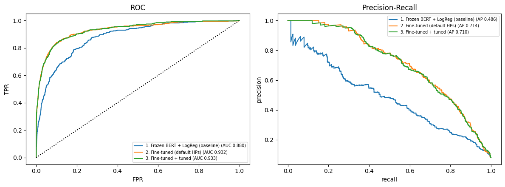
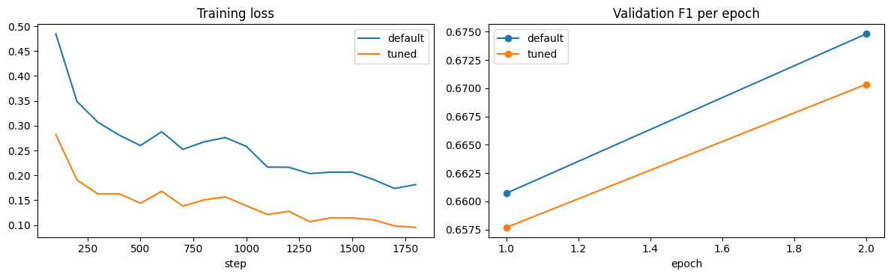
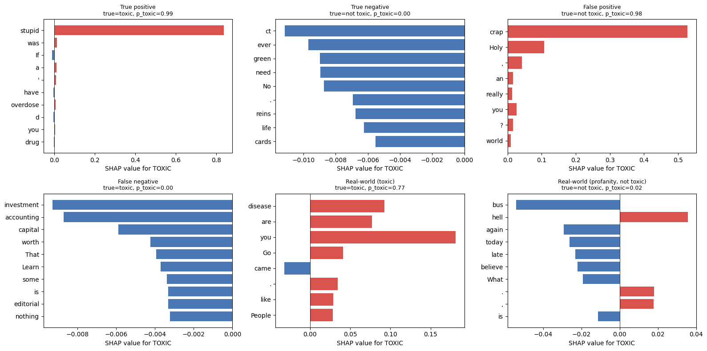

# Assignment 03: [Toxic Comment Classification with Transfer Learning, Fine-Tuning, Hyperparameter Tuning and Interpretability](readme_pkg)

**Name:** Tarek Alam Bhuiyan
**Student ID:** 1000129291

---

## 1. Summary

The task is to classify a user comment as _toxic_ or _not toxic_ on the Civil Comments dataset. The pipeline (all in one notebook, `assignment03_toxic_comment_classification.ipynb`) has four stages:

1. **Transfer learning (baseline):** a frozen `distilbert-base-uncased` encoder used as a feature extractor, with a logistic regression head.
2. **Fine-tuning:** the same model unfrozen and trained end-to-end with default hyperparameters.
3. **Hyperparameter tuning:** Optuna (TPE sampler with a median pruner), 12 trials over 7 hyperparameters.
4. **Interpretability:** SHAP explanations for six selected predictions (four test-set cases and two real-world sentences).

Headline results. The **test set** (5,000 comments, 401 toxic) was never used for any selection, so it is the number to report. The **validation set** (5,000 comments, 396 toxic) was used to pick the best epoch and the best tuning trial, so its scores are slightly optimistic for the two fine-tuned models.

**Test set (final, unbiased estimate):**

| Model                                                 | Precision | Recall | F1        | ROC-AUC   | PR-AUC    |
| ----------------------------------------------------- | --------- | ------ | --------- | --------- | --------- |
| 1. Frozen DistilBERT + logistic regression (baseline) | 0.271     | 0.786  | 0.403     | 0.880     | 0.486     |
| 2. Fine-tuned, default hyperparameters                | 0.610     | 0.683  | **0.645** | 0.932     | **0.714** |
| 3. Fine-tuned, tuned hyperparameters                  | **0.680** | 0.594  | 0.634     | **0.933** | 0.710     |

**Validation set (used for model selection):**

| Model                                                 | Precision | Recall | F1        | ROC-AUC | PR-AUC    |
| ----------------------------------------------------- | --------- | ------ | --------- | ------- | --------- |
| 1. Frozen DistilBERT + logistic regression (baseline) | 0.260     | 0.727  | 0.383     | 0.857   | 0.429     |
| 2. Fine-tuned, default hyperparameters                | 0.654     | 0.697  | **0.675** | 0.952   | 0.743     |
| 3. Fine-tuned, tuned hyperparameters                  | **0.742** | 0.611  | 0.670     | 0.952   | **0.745** |

Main findings:

- **Fine-tuning is the big win.** Unfreezing the encoder raised F1 from 0.403 to 0.645 and PR-AUC from 0.486 to 0.714.
- **Hyperparameter tuning did not improve ranking quality.** ROC-AUC and PR-AUC are essentially unchanged (differences of 0.001 and 0.003), and F1 is slightly lower (0.634 against 0.645). Tuning changed the _operating point_ (higher precision, lower recall) rather than the model's ability to separate the classes. Section 5 explains why.
- **The model relies heavily on lexical cues.** On real-world text it caught overt insults but missed a sarcastic insult and a veiled threat, and it flagged a neutral sentence containing the word "Gay" (Sections 6 and 7).

---

## 2. Setup and reproducibility

| Item                | Value                                                                                                                  |
| ------------------- | ---------------------------------------------------------------------------------------------------------------------- |
| Hardware            | Google Colab, Tesla T4 GPU                                                                                             |
| Libraries           | `transformers`, `datasets`, `accelerate`, `optuna`, `shap`, `scikit-learn`, `pandas`, `matplotlib`, `seaborn`, PyTorch |
| Random seed         | 42 (Python, NumPy, PyTorch, Optuna sampler, Trainer)                                                                   |
| Precision           | fp16 mixed precision for fine-tuning and feature extraction                                                            |
| Max sequence length | 128 tokens (truncation, dynamic padding per batch)                                                                     |
| Total tuning time   | about 14 minutes for 12 trials                                                                                         |

All figures used in this report are saved from the notebook and stored in `figures/`.

---

## 3. Dataset and labelling

**Dataset:** Civil Comments, loaded with `load_dataset("google/civil_comments")`. The official splits contain 1,804,874 training, 97,320 validation and 97,320 test comments. The comment is in the `text` column and the annotator-averaged toxicity score (0 to 1) is in the `toxicity` column.

**Label threshold:** a comment is labelled **toxic (1) if `toxicity >= 0.5`**, otherwise **not toxic (0)**.

**Subsets.** Because of compute limits, random subsets were drawn (shuffled with a fixed seed) from each official split:

| Subset                                                  | Source split        | Size   | Toxic | Toxic % |
| ------------------------------------------------------- | ------------------- | ------ | ----- | ------- |
| Train                                                   | official train      | 30,000 | 2,380 | 7.93    |
| Tuning subset (first rows of the shuffled train subset) | official train      | 10,000 | 800   | 8.00    |
| Validation                                              | official validation | 5,000  | 396   | 7.92    |
| Test                                                    | official test       | 5,000  | 401   | 8.02    |

The subsets preserve the natural class ratio of roughly 8% toxic. Training, validation and test data come from three different official splits, so there is no overlap between them. The tuning subset is a part of the training subset and is evaluated on the same validation set as every other run.

  
   
  <em><b>Figure 1:</b> Toxicity score distribution and class balance across splits (Civil Comments dataset).</em>

**Consequence of the imbalance.** About 92% of comments are non-toxic, so a classifier that always predicts "not toxic" reaches roughly 92% accuracy. Accuracy is therefore not used for model selection. The report uses **precision, recall and F1 for the toxic class, ROC-AUC and PR-AUC**, and models are selected by **validation F1**. PR-AUC is the most informative single number here because it ignores the decision threshold and is sensitive to the rare class.

---

## 4. Model choice

**Model used: `distilbert-base-uncased`** (6 transformer layers, about 66 million parameters, 768-dimensional hidden states).

**Why this model:**

- **It is BERT-based and pre-trained.** DistilBERT is a distilled version of BERT-base, so it satisfies the "BERT-based model" requirement and provides general language knowledge for transfer learning.
- **Compute budget.** It is about 40% smaller and about 60% faster than BERT-base while keeping most of its language-understanding quality. This made it possible to run a baseline, a default fine-tune, a 12-trial hyperparameter search and a final retrain on a single T4 GPU in a short time.
- **Fair comparison.** The same checkpoint is used for the frozen baseline and for fine-tuning, so any difference between them comes from the training strategy only.

**Known limitation:** the model is uncased, so it cannot use capitalisation (for example ALL-CAPS shouting) as a toxicity cue, and it is smaller than BERT-base or RoBERTa, which would likely score a few points higher.

---

## 5. Pipeline and results

### 5.1 Transfer learning: frozen feature extractor (baseline, no tuning)

- All encoder parameters were frozen (`requires_grad = False`); the notebook confirms **0 trainable encoder parameters**.
- For each comment, the last hidden states were **mean-pooled over non-padding tokens** to give one 768-dimensional vector.
- Features were standardised (`StandardScaler`) and fed to a **logistic regression** (`C = 1.0`, `class_weight="balanced"`, `max_iter = 3000`). Only this head is trained.

### 5.2 Fine-tuning (default hyperparameters, no tuning)

- All encoder weights and the new classification head were trained end-to-end with a weighted cross-entropy loss.
- Class weights were `[1, (n_neg / n_pos) ** 0.5]`, which is about `[1, 3.41]` on the training subset. This is a softened inverse-frequency weighting that raises the cost of missing a toxic comment.
- Default hyperparameters: learning rate 2e-5, batch size 32, weight decay 0.01, 2 epochs, linear schedule.
- The best epoch by validation F1 was kept (`load_best_model_at_end`). Validation F1 was about 0.661 after epoch 1 and 0.675 after epoch 2.

### 5.3 Hyperparameter tuning

**Method: Optuna with the TPE sampler (Bayesian optimisation) and a median pruner.**

- TPE models which regions of the search space gave good scores, so it needs fewer trials than grid or random search. This matters because each full trial costs about 2 minutes.
- The median pruner stops a trial after epoch 1 if its validation F1 is below the median of earlier trials (the first 3 trials are never pruned). This saved time: pruned trials took about 0.6 to 0.8 minutes against 1.8 to 2.5 minutes for completed ones.
- **Objective:** maximise validation F1 (toxic class).
- **Data:** each trial trains on the 10,000-comment tuning subset and is scored on the validation set. The **test set was never used** during tuning. After the search, the best configuration was retrained on the full 30,000-comment training subset.

**Search space (7 hyperparameters, 12 trials):**

| Hyperparameter     | Range                                                            |
| ------------------ | ---------------------------------------------------------------- |
| Learning rate      | log-uniform [1e-5, 1e-4]                                         |
| Batch size         | {16, 32}                                                         |
| Weight decay       | uniform [0.0, 0.1]                                               |
| Warmup ratio       | uniform [0.0, 0.2] (see the note below)                          |
| Epochs             | {2, 3}                                                           |
| LR scheduler       | {linear, cosine}                                                 |
| Class-weight power | {0.0, 0.5, 1.0} (weight on toxic class is `(n_neg/n_pos)^power`) |

> **Note on warmup.** In the executed notebook, `warmup_ratio` was sampled by Optuna but was not passed to `TrainingArguments`, so it had no effect on training. This matters for interpreting the importance plot below.

**Tuning results (screenshot from the notebook):**

  
   
  <em><b>Figure 2:</b> Optuna trial summary table recorded across 12 hyperparameter configurations.</em>

The same results as text (sorted by validation F1; for pruned trials the score is the F1 reached at epoch 1, when they were stopped):

| Trial  | Val F1     | LR       | Scheduler | Epochs | Batch | Class-weight power | Warmup ratio | Weight decay | State    | Minutes |
| ------ | ---------- | -------- | --------- | ------ | ----- | ------------------ | ------------ | ------------ | -------- | ------- |
| **11** | **0.6563** | 2.18e-05 | linear    | 2      | 32    | 0.0                | 0.009        | 0.089        | complete | 1.8     |
| 2      | 0.6554     | 1.96e-05 | linear    | 3      | 32    | 0.0                | 0.040        | 0.079        | complete | 2.5     |
| 0      | 0.6515     | 2.37e-05 | cosine    | 2      | 16    | 0.5                | 0.031        | 0.060        | complete | 2.1     |
| 6      | 0.6425     | 1.38e-05 | cosine    | 2      | 16    | 1.0                | 0.154        | 0.099        | pruned   | 0.7     |
| 10     | 0.6418     | 3.22e-05 | linear    | 3      | 32    | 1.0                | 0.065        | 0.005        | pruned   | 0.6     |
| 4      | 0.6397     | 1.81e-05 | linear    | 2      | 16    | 0.0                | 0.109        | 0.052        | pruned   | 0.7     |
| 7      | 0.6361     | 1.19e-05 | cosine    | 2      | 16    | 0.5                | 0.125        | 0.086        | pruned   | 0.7     |
| 9      | 0.6352     | 1.28e-05 | cosine    | 3      | 32    | 0.0                | 0.102        | 0.031        | pruned   | 0.6     |
| 1      | 0.5946     | 9.33e-05 | linear    | 2      | 16    | 0.5                | 0.037        | 0.018        | complete | 1.9     |
| 8      | 0.5942     | 7.71e-05 | linear    | 3      | 16    | 0.0                | 0.152        | 0.071        | pruned   | 0.8     |
| 5      | 0.4629     | 8.35e-05 | cosine    | 2      | 32    | 1.0                | 0.065        | 0.005        | pruned   | 0.6     |
| 3      | 0.1468     | 8.89e-05 | linear    | 3      | 16    | 1.0                | 0.020        | 0.030        | pruned   | 0.7     |

**Best configuration (trial 11):** learning rate 2.18e-5, batch size 32, weight decay 0.0885, 2 epochs, linear schedule, class-weight power 0.0 (an unweighted loss). Warmup ratio 0.009 was sampled but not applied.

  
   
  <em><b>Figure 3:</b> Optuna optimization history (left) and parameter importance via fANOVA (right).</em>

  
   
  <em><b>Figure 4:</b> Validation F1 score scatter across learning rate, weight decay, and warmup ratio.</em>

**What the search shows:**

- **Learning rate is the dominant factor.** Every trial with a learning rate of 7.7e-5 or higher scored 0.59 or lower, and the worst trials (3 and 5, F1 0.147 and 0.463) used learning rates near 8.5e-5 to 8.9e-5, where fine-tuning became unstable. All trials between 1.2e-5 and 3.2e-5 landed in a narrow band of 0.635 to 0.656. This is the usual behaviour for BERT-style models: a safe window around 2e-5 to 5e-5, and instability above it.
- **The top of the ranking is a plateau.** The three completed trials near 2e-5 differ by only 0.005 in F1 (0.6515 to 0.6563), which is smaller than the noise expected from a validation set with 396 toxic comments. The "best" trial is therefore only marginally better than its neighbours.
- **The importance plot is not reliable.** fANOVA assigns weight decay about 0.39, learning rate about 0.37 and warmup ratio about 0.23, with the rest near zero. But warmup ratio had no effect on training (note above), so its 0.23 is pure noise. With only 12 trials, and weight decay and learning rate correlated (low weight decay happened to co-occur with several high-learning-rate failures), these importance values should not be read as causal. The learning-rate scatter plot is the more trustworthy evidence.
- **Pruning was somewhat aggressive.** Trials 6, 7 and 9 (learning rates 1.2e-5 to 1.4e-5) were stopped at epoch 1 with F1 around 0.635 to 0.643. Low learning rates start slowly, so they may have caught up by the end of training. The default configuration, for example, gained about 0.014 F1 from epoch 1 to epoch 2.
- **Class-weight power did not affect validation F1 during tuning** (importance near zero, and the best trials include both 0.0 and 0.5), but it does change the precision/recall balance of the final model, as shown next.

### 5.4 Results: without tuning and with tuning

Test-set metrics at the fixed decision threshold of 0.5 (5,000 comments, 401 toxic):

| Model                                   | Accuracy   | Precision  | Recall     | F1         | ROC-AUC    | PR-AUC     |
| --------------------------------------- | ---------- | ---------- | ---------- | ---------- | ---------- | ---------- |
| 1. Frozen BERT + LogReg (baseline)      | 0.8136     | 0.2713     | **0.7855** | 0.4033     | 0.8797     | 0.4858     |
| 2. Fine-tuned (default hyperparameters) | 0.9396     | 0.6102     | 0.6833     | **0.6447** | 0.9317     | **0.7137** |
| 3. Fine-tuned + tuned                   | **0.9450** | **0.6800** | 0.5935     | 0.6338     | **0.9330** | 0.7103     |

Validation-set metrics (used for model selection):

| Model                              | Precision  | Recall | F1         | ROC-AUC | PR-AUC     |
| ---------------------------------- | ---------- | ------ | ---------- | ------- | ---------- |
| 1. Frozen BERT + LogReg (baseline) | 0.2602     | 0.7273 | 0.3832     | 0.8570  | 0.4292     |
| 2. Fine-tuned (default)            | 0.6540     | 0.6970 | **0.6748** | 0.9516  | 0.7432     |
| 3. Fine-tuned + tuned              | **0.7423** | 0.6111 | 0.6704     | 0.9517  | **0.7451** |

Confusion counts on the test set (recovered from the reported precision and recall):

| Model                   | True positives | False positives | False negatives | True negatives |
| ----------------------- | -------------- | --------------- | --------------- | -------------- |
| 1. Frozen baseline      | 315            | 846             | 86              | 3,753          |
| 2. Fine-tuned (default) | 274            | 175             | 127             | 4,424          |
| 3. Fine-tuned + tuned   | 238            | 112             | 163             | 4,487          |

<em><b>Figure 5:</b> Performance comparison across models on the test set.</em>

<em><b>Figure 6:</b> Normalized confusion matrices for baseline, fine-tuned, and hyperparameter-tuned models.</em>

<em><b>Figure 7:</b> Receiver Operating Characteristic (ROC) and Precision-Recall (PR) curves.</em>

<em><b>Figure 8:</b> Training loss and validation F1 progress across training epochs.</em>

#### Justification: frozen baseline against fine-tuned model

Fine-tuning improved nearly every metric. The most important changes:

- **F1: 0.403 to 0.645. PR-AUC: 0.486 to 0.714. ROC-AUC: 0.880 to 0.932.** The threshold-free metrics improved too, so the fine-tuned encoder genuinely _separates_ toxic from non-toxic comments better; this is not an artefact of where the threshold sits.
- **Precision: 0.27 to 0.61.** The baseline produced 846 false positives on 4,599 non-toxic comments, so only about one in four of its "toxic" predictions was correct. Fine-tuning cut false positives to 175.
- **Recall fell from 0.786 to 0.683.** The baseline's high recall was bought by flagging far too many comments, helped by `class_weight="balanced"`. It is a high-recall, low-precision operating point, not a sign of a better model.

Why the frozen features perform worse: the pre-trained DistilBERT representations are trained for general language modelling (predicting masked words), not for toxicity. Mean-pooled frozen vectors encode topic, syntax and sentiment, but toxicity depends on specific cues (insults aimed at a person, slurs, dehumanising words) that a single linear layer on generic features cannot isolate well. Fine-tuning updates all layers, so the encoder reorganises its representation around exactly those cues. The baseline is still far above chance (ROC-AUC 0.88), which shows that transfer learning does carry useful signal even without adaptation.

#### Justification: without tuning against with tuning

Tuning did **not** improve overall quality in this experiment, and it is more accurate to say so than to claim a gain:

- **Ranking quality is unchanged.** ROC-AUC 0.9317 to 0.9330 and PR-AUC 0.7137 to 0.7103 on test, and 0.7432 to 0.7451 on validation. These differences are far below the sampling noise of a test set with 401 positives.
- **F1 is slightly lower** (test 0.6447 to 0.6338, validation 0.6748 to 0.6704).
- **The operating point moved.** Precision rose from 0.610 to 0.680 (false positives 175 to 112) and recall fell from 0.683 to 0.594 (true positives 274 to 238). Accuracy rose slightly (0.9396 to 0.9450) because non-toxic comments dominate.

The most likely explanation is the **class-weight power**. The tuned configuration chose 0.0, which removes class weighting entirely (the default used a weight of about 3.4 on toxic comments). Without the penalty for missing toxic comments, the model becomes more conservative: fewer toxic predictions, more of them correct, and more misses. That matches the precision-up, recall-down pattern. The unchanged AUC values show that the model's underlying ranking did not change; only its default threshold behaviour did.

Other reasons the search found little to gain:

- **The default was already near the optimum.** The default learning rate (2e-5) sits inside the best region found (about 1.9e-5 to 2.4e-5). The search space therefore mostly confirmed the default rather than beating it.
- **The search ran on a smaller, noisier problem.** Trials used 10,000 training comments with only 800 toxic examples and were scored on 396 toxic validation examples. F1 at a fixed 0.5 threshold is noisy at that size, and the 0.005 gap among the top trials is within that noise.
- **The objective mixes two things.** F1 at a threshold of 0.5 rewards both ranking quality and where the probabilities happen to sit relative to 0.5. A threshold-independent objective such as PR-AUC, or tuning the threshold itself on the validation set, would separate these effects.
- **Warmup was not applied** (note in Section 5.3), so one of the seven searched dimensions was inert, which reduces the effective search to six hyperparameters.

What the tuning stage did deliver: it identified the stable learning-rate window, showed that learning rates above about 7e-5 break training, and exposed a precision/recall trade-off controlled by class weighting. Which model is "better" depends on the use case. For moderation where wrongly removing a comment is costly, the tuned model (precision 0.68) is preferable; for a safety setting where missing toxic content is costlier, the default fine-tuned model (recall 0.68) is preferable.

#### Why the test results are lower than the validation results

For both fine-tuned models the test scores are a little lower than the validation scores. This is normal and is not a sign of a bug or of data leakage. The differences (test minus validation) are:

| Model                   | Precision | Recall | F1     | ROC-AUC | PR-AUC |
| ----------------------- | --------- | ------ | ------ | ------- | ------ |
| 1. Frozen baseline      | +0.011    | +0.058 | +0.020 | +0.023  | +0.057 |
| 2. Fine-tuned (default) | -0.044    | -0.014 | -0.030 | -0.020  | -0.030 |
| 3. Fine-tuned + tuned   | -0.062    | -0.018 | -0.037 | -0.019  | -0.035 |

There are three reasons, in order of importance:

1. **Selection bias on the validation set.** The validation set was used to choose the best epoch of every fine-tuning run (`load_best_model_at_end`, scored on validation F1) and, for the tuned model, to choose the best of 12 trials. Picking the maximum of several noisy scores is optimistic by construction, so the winner's validation score is slightly inflated. The test set was never used for any decision: the trainer only evaluates on validation, and the test set is used only for the final prediction. This is exactly why a separate test set exists. The pattern supports this explanation: the **frozen baseline**, whose only choice (fixed regularisation) did not use the validation set, shows no drop (test is slightly _higher_), and the tuned model, which had the most selection on validation, has the largest drop in F1 (-0.037 against -0.030 for the default).
2. **Sampling noise.** Each set has only about 400 toxic comments. The standard error of recall, precision or F1 at this size is roughly 0.02 to 0.03, so gaps of 0.02 to 0.04 are around one standard error and are well within noise. The baseline's opposite gap (test higher by 0.02 to 0.06) shows that the two random samples simply differ by about this much in either direction.
3. **The two subsets are different random samples.** They come from different official splits, so they contain different comments, and the share of hard examples (sarcasm, implicit toxicity, profanity without a target) differs slightly. The ROC-AUC gap of about 0.02 for the fine-tuned models is a little larger than selection bias alone would explain, which is consistent with this.

**What this means for the conclusions.** The ranking of the models is the same on both sets: the fine-tuned models are far better than the frozen baseline on every threshold-free metric and on F1, and the default and tuned models are practically tied (validation F1 0.675 against 0.670, test F1 0.645 against 0.634, ROC-AUC and PR-AUC within 0.003). The test numbers should be quoted as the final performance, and the validation numbers as the evidence used for selection. A larger test set, or a bootstrap confidence interval, would be needed to say anything about differences of this size.

---

## 6. Test on real-world text

Twelve hand-written sentences, not taken from Civil Comments, were classified by the tuned model at the 0.5 threshold. They cover clear insults, polite disagreement, profanity that is not aimed at anyone, neutral identity statements, sarcasm, a veiled threat and neutral text. The "expected" label is my own judgement, and the "check" column explains whether the prediction is reasonable.

| #   | Input                                                                                                      | Predicted | P(toxic) | Expected  | Check of the prediction                                                                                                                                                                         |
| --- | ---------------------------------------------------------------------------------------------------------- | --------- | -------- | --------- | ----------------------------------------------------------------------------------------------------------------------------------------------------------------------------------------------- |
| 1   | You are a complete idiot and nobody wants you here.                                                        | toxic     | 0.988    | toxic     | Correct. A direct personal insult combined with social exclusion.                                                                                                                               |
| 2   | I respectfully disagree with the author; the data in the second paragraph does not support the conclusion. | not toxic | 0.002    | not toxic | Correct. It criticises the argument, not the person, and the tone is polite.                                                                                                                    |
| 3   | This is the dumbest article I have ever read. The writer should be fired.                                  | toxic     | 0.980    | toxic     | Correct, but borderline. It attacks the work and calls for punishment, though not through slurs or threats; annotators could reasonably disagree.                                               |
| 4   | What the hell, I can't believe the bus is late again today.                                                | not toxic | 0.017    | not toxic | Correct. Mild profanity with no target, so complaining about a situation is not an attack.                                                                                                      |
| 5   | As a Muslim woman, I think the new policy will help my community.                                          | not toxic | 0.048    | not toxic | Correct. The identity term is used neutrally and the model does not penalise it here.                                                                                                           |
| 6   | People like you are a disease on this country. Go back where you came from.                                | toxic     | 0.769    | toxic     | Correct. Dehumanising and xenophobic. Its probability is the lowest among the toxic detections, though, because it contains no profanity.                                                       |
| 7   | Great job destroying the competition last night, that was a brutal game!                                   | not toxic | 0.010    | not toxic | Correct. Violent vocabulary ("destroying", "brutal") used as sports praise; the model did not fall for the keywords.                                                                            |
| 8   | Oh sure, because you obviously know everything, genius.                                                    | not toxic | 0.004    | toxic     | **Wrong (missed).** Sarcastic and condescending, aimed at a person, but built from positive words. This is mild toxicity and the label is arguable, yet the model is nearly certain it is safe. |
| 9   | Keep talking and see what happens to you after work.                                                       | not toxic | 0.002    | toxic     | **Wrong (missed).** A veiled threat. It contains no profane or insulting word, so the model finds no cue. This is the most serious miss.                                                        |
| 10  | The city council will meet on Tuesday to discuss the new bike lanes.                                       | not toxic | 0.003    | not toxic | Correct. Neutral, informative text.                                                                                                                                                             |
| 11  | Gay people deserve the same rights as everyone else.                                                       | toxic     | 0.616    | not toxic | **Wrong (false alarm).** A supportive sentence flagged because of an identity term. See the discussion below.                                                                                   |
| 12  | Shut up, you worthless piece of trash.                                                                     | toxic     | 0.987    | toxic     | Correct. Direct abuse.                                                                                                                                                                          |

**Agreement with my manual labels: 9 of 12 (75%).** The model got 4 of 6 toxic sentences and 5 of 6 non-toxic sentences right.

What this tells us:

- **It handles overt, lexical toxicity well.** Insults and abuse (1, 3, 12) are detected with probabilities above 0.97, and it correctly ignores aggressive-sounding but harmless text (4, 7).
- **It misses implicit toxicity.** Sarcasm (8) and a veiled threat (9) get probabilities of 0.004 and 0.002. The model has learned surface cues, not intent. This is consistent with the false-negative analysis in Section 7.
- **There is identity-term bias.** Sentence 11 is supportive but contains "Gay" and is flagged at 0.616, while the similar sentence 5 with "Muslim" scores only 0.048. Civil Comments is known to contain many toxic comments that mention identity groups, so a model can learn the shortcut "identity term implies toxic". The inconsistency between the two identity terms suggests the bias is uneven across groups. A SHAP run on this sentence would be the natural next check, but it was not part of the six explained cases.
- **Caveats:** the sample is tiny, the expected labels are my own, and cases 3 and 8 are subjective. These results illustrate behaviour; they are not a statistical estimate of real-world accuracy.

---

## 7. Explainability analysis

### 7.1 Method and why

**Method: SHAP (SHapley Additive exPlanations)**, using `shap.Explainer` on the Hugging Face text-classification pipeline, which selects the Partition explainer with a text masker. Each token receives a value showing how much it pushed the predicted probability of the **TOXIC** class up (positive) or down (negative). Because the pipeline outputs class probabilities, SHAP values here are on the probability scale, and a token with +0.84 contributes 0.84 of probability to the toxic score.

**Why SHAP rather than attention weights or LIME:**

- **Faithful to the output.** SHAP measures the effect on the model's prediction of masking tokens. Attention weights show where the model looked, not what drove the decision, and are known to be unreliable as explanations.
- **Additive and comparable.** Token values sum to the difference between the prediction and the baseline, so contributions are on one scale across examples. This lets us compare a clearly toxic sentence with a harmless one.
- **Model-agnostic and supported for transformers.** It works directly on the fine-tuned model without changing it, and renders token-level highlights.

The cost is runtime: the six explanations took about 22 seconds in total here, which is fine for a small selected set but would be slow for thousands of comments.

### 7.2 Selected cases

Six cases were chosen to cover every outcome type, taking the test-set examples with the most confident prediction in each category (limited to comments of 45 words or fewer for readability), plus two real-world sentences from Section 6.

<em><b>Figure 9:</b> Top SHAP token importance values for the six selected evaluation cases.</em>

| Case                              | Text (shortened)                                                                                                                                           | True      | P(toxic) | Top tokens by SHAP (value)                                                           |
| --------------------------------- | ---------------------------------------------------------------------------------------------------------------------------------------------------------- | --------- | -------- | ------------------------------------------------------------------------------------ |
| True positive                     | "If stupid was a drug, you'd have overdosed"                                                                                                               | toxic     | 0.988    | stupid (+0.84), was (+0.01), If (-0.01), a (+0.01), ' (+0.01)                        |
| True negative                     | "No. If that was true then the green cards would be permanent and issued for life. No need to reinspect ever."                                             | not toxic | 0.001    | ct (-0.01), ever (-0.01), green (-0.01), need (-0.01), No (-0.01)                    |
| False positive                    | "Are you really saying 12.50 an hour is good? Holy crap, are you related to Bezo's? The largest company in the world ... can't pay more then slave wages?" | not toxic | 0.982    | crap (+0.53), Holy (+0.11), , (+0.04), you (+0.03), ? (+0.02)                        |
| False negative                    | "That investment ... is worth nothing." No, it's worth 50% ... Learn some capital accounting before writing ludicrous editorials.                          | toxic     | 0.001    | investment (-0.01), accounting (-0.01), capital (-0.01), worth (-0.00), That (-0.00) |
| Real-world (toxic)                | "People like you are a disease on this country. Go back where you came from."                                                                              | toxic     | 0.769    | you (+0.18), disease (+0.09), are (+0.08), you (+0.05), Go (+0.04)                   |
| Real-world (profanity, not toxic) | "What the hell, I can't believe the bus is late again today."                                                                                              | not toxic | 0.017    | bus (-0.05), hell (+0.04), again (-0.03), today (-0.03), late (-0.02)                |

### 7.3 Analysis of each case

**True positive: "If stupid was a drug, you'd have overdosed" (0.988).** A single token explains the prediction. "stupid" contributes +0.84 of the 0.988 probability, and every other token is within 0.01 of zero. The model has learned that an insult word directed at a person (here "you'd have overdosed" supplies the target) is a strong toxicity signal. This is what a human would pick as the key word, so the explanation is plausible. It also shows how concentrated the model's evidence can be: one word carries almost the whole decision.

**True negative: a discussion of green cards (0.001).** No token is above 0.01 in magnitude. Contributions such as "ct", "ever", "green" and "need" are tiny and slightly negative. The model is not finding strong evidence of _non_-toxicity; it is finding no evidence of toxicity at all, because the text has no insults, slurs or threats. The calm, argumentative tone and the policy vocabulary leave the toxic probability near zero.

**False positive: the "Holy crap" comment (0.982, true label not toxic).** The decision is driven by "crap" (+0.53), with "Holy" adding +0.11. The rest of the comment, which is an angry but mostly argumentative complaint about low wages ("are you related to Bezo's?"), contributes almost nothing. The model reacted to a mild profanity token even though nobody was personally attacked in a way annotators judged toxic. This reveals a **profanity shortcut**: the presence of an expletive is enough to push the probability near 1. It also shows an inconsistency, because "hell" in the real-world bus sentence contributes only +0.04. Expletives that stand alone as an exclamation ("Holy crap") are treated much more severely than a mild word inside a mundane complaint, so the model's response to profanity depends on the surrounding wording rather than on whether anyone is attacked.

**False negative: the "capital accounting" comment (0.001, true label toxic).** The comment is condescending ("Learn some capital accounting before writing ludicrous editorials") but contains no profanity or slur. The top tokens are all topic words from the financial discussion ("investment", "accounting", "capital", "worth"), each worth about -0.01, and none of the insulting words rank among the most influential tokens, so their contribution is smaller than 0.01. The model treats the text as a polite-sounding financial argument. This confirms the finding from the real-world test (sentences 8 and 9): **toxicity expressed through tone, condescension or implication, without explicit toxic vocabulary, is invisible to this model.**

**Real-world toxic sentence (0.769).** The attribution is spread across several tokens: the pronoun "you" (+0.18 and +0.05), "disease" (+0.09), "are" (+0.08) and "Go" (+0.04). Two things stand out. First, the second-person pronoun carries the largest single contribution, which suggests the model has learned that statements aimed _at_ a person ("you") are riskier than general statements. Second, "disease" as a dehumanising metaphor contributes positively but modestly. This sentence is clearly toxic by any human reading (dehumanisation plus an exclusion demand), yet it scores well below the 0.98 of plain insults. Hateful language expressed without profanity gets less confident treatment, which is a safety-relevant weakness.

**Real-world profanity sentence (0.017).** "hell" contributes only +0.04, while "bus" (-0.05), "again" (-0.03), "today" (-0.03) and "late" (-0.02) push the other way. The everyday, complaint-about-a-situation context outweighs the profanity, and the model correctly concludes that nobody is being attacked. Together with the false positive above, this shows that the model does take context into account, but inconsistently.

### 7.4 Overall interpretation

- **Where the model is right, it is right for sensible reasons.** Insult words directed at a person (stupid, idiot, disease, "you") are the strongest positive attributions, and mundane vocabulary pushes toward non-toxic.
- **Its errors have two recognisable causes.** False alarms come from **profanity or identity-term shortcuts** (the "crap" case, and sentence 11 in Section 6). Misses come from **implicit toxicity with no toxic vocabulary** (the capital accounting comment, sarcasm and the veiled threat).
- **Practical implication.** The model should not be used alone for moderation: it over-reacts to certain words and under-reacts to hostile intent. Training data with more implicit toxicity, counterfactual examples that swap identity terms, or a larger model could reduce these errors.
- **Limits of this analysis.** Six explanations are a small, hand-picked sample, SHAP values for text depend on the masking strategy, and Partition SHAP values for long texts are approximations. The cases show typical failure modes; they do not quantify how common each one is.

---

## 8. Limitations

- **Subset training.** The model was trained on 30,000 of 1.8 million available comments, with only 2,380 toxic examples. More data, particularly more toxic and implicitly toxic examples, would probably help.
- **Small number of positives for evaluation.** The test set has 401 toxic comments, so a single metric such as recall carries roughly a few points of sampling uncertainty. Differences like the 0.010 gap in F1 between default and tuned models are not statistically meaningful. Results come from one random seed.
- **Tuning on a subset.** The search used 10,000 comments and only 12 trials, and the pruner may have stopped slow-starting low-learning-rate trials too early.
- **Warmup was not applied** during training (Section 5.3), so the search over warmup ratio had no effect, and the reported importance of that parameter is spurious.
- **Objective choice.** Tuning on F1 at a fixed 0.5 threshold mixes ranking quality with calibration. No separate decision-threshold selection was performed.
- **Real-world test and labels.** The 12 sentences are few and hand-labelled by the author, and a couple (3 and 8) are subjective.
- **Single model family.** Only DistilBERT (uncased) was tested, with no comparison against BERT-base or RoBERTa.

---

## 9. Files

| File                                              | Content                                                                                                 |
| ------------------------------------------------- | ------------------------------------------------------------------------------------------------------- |
| `assignment03_toxic_comment_classification.ipynb` | Complete pipeline: data, frozen baseline, fine-tuning, Optuna tuning, evaluation, real-world test, SHAP |
| `README.md`                                       | This report                                                                                             |
| `figures/`                                        | Figures used in this report (tuning table screenshot, curves, confusion matrices, SHAP plots)           |
